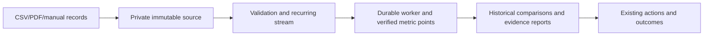
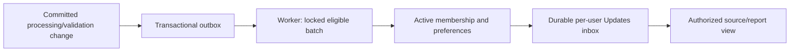

# Business intelligence extension: architecture and delivery

## Verified baseline (2026-10-20)

Default branch: `main`, initially `d152c821fd5f873723a4380d7cc3f7a7d8e1e344`.
The previous source-download branch is merged. Untracked Android/mobile files and
the local Android testing note are pre-existing and excluded from this work.
`sources/` remains read-only. Fresh `npm test`: 370 passed, 15 database-dependent
skipped, zero failed. Local Docker availability must not be confused with CI's
PostgreSQL acceptance environment.

## Actual architecture and reuse

| Boundary | Production implementation | Extension decision |
| --- | --- | --- |
| UI | `web-app/app.js`, CSS, hash routes, Lucide | Keep framework and navigation; modular new views |
| API | `src/webapp/production-app.mjs`, `scripts/production-server.mjs` | Reuse authentication, errors and body limits |
| Auth | `src/auth/core.mjs`, identity repository, PostgreSQL session context | Cookie/CSRF and mobile-v1 bearer contracts unchanged |
| Tenant scope | `withTenantTransaction`, memberships, business.read/write, RLS | Reauthorize every request, deep link and recipient |
| Ingestion | production ingestion service, manual-entry service/repository | Keep source bytes, monthly stream identity and duplicate reservations |
| Processing | `processing_jobs`, `production-worker.mjs`, immutable S3 reads | Reuse worker lifecycle; notifications cannot fail ingestion |
| Calculations | verified metrics/comparisons, evidence-engine/report cubes | No notification-derived metrics or changed historical definitions |
| Findings/actions | verified findings, business actions/outcomes repositories | Extend instead of creating a competing task system |
| Exports | `src/reports/export.mjs`, evidence report definitions | Extend authenticated exports; no public sharing by default |
| Existing alerts | `src/alerts/monitoring.mjs`, migration 0012 | Rule/event concepts exist, but no production recipient inbox/outbox |
| Database | PostgreSQL, migrations through 0032, explicit runtime grants | Additive migrations plus bootstrap grants and restricted-role tests |
| Hosting | Northflank biznoryx combined API service; separate worker | Existing main CI/CD automatically builds/deploys merged code |
| Android | Capacitor remediation is on a separate, unmerged PR | Do not merge it or assume Web Push/native delivery support |

Migration inspection includes the foundation and later **verified_** tables;
older in-memory/phase models are not proof that a production workflow exists.
Environment names are read from code, never from secret-value dumps. Private
S3, Resend and Paystack integrations stay unchanged.

## Delivery sequence and acceptance

1. **Updates foundation and UI**: transactional source events, per-recipient
   inbox/read/snooze state, preferences, bounded retry/dead-letter visibility,
   optional per-organization enablement. Add a header bell, Updates view and
   accessible bounded toasts. Initially only upload correction and confirmed
   processing events, not speculative live financial alerts. Tests: rollback
   atomicity, replay/concurrent workers, restricted-role RLS, revoked membership,
   per-user state, preferences, disabled/unmigrated runtime, CSRF, mobile UI.
2. **Everyday records**: add extraction proposals with source locations and
   owner-confirmed immutable import versions. Must evaluate redacted Nigerian
   receipts/notebook samples and documented provider cost/retention/accuracy
   before selecting a provider. No API key, representative evaluation set or
   approval to transmit document contents is assumed. Existing CSV/manual/PDF
   paths remain available; image extraction is not advertised as implemented.
3. **Capital protection**: immutable dated scenarios; exact decimal available
   balances, identified obligations, reserve, working capital, transfers and
   withdrawals. Block incomplete/stale input; never equate revenue/profit with
   cash. Independent fixtures, waterfall plus accessible deduction table.
4. **Leakage investigations**: normalized tenant-owned transaction records,
   provenance, units/currency/period, exact-match rules, bounded split allocation
   ledger with concurrency constraints, reversible reviewer decisions. Report
   cubes alone cannot prove sales/receipts or supplier quantity reconciliation.
5. **Guided plans**: extend existing verified actions/outcomes with acceptance,
   review dates, resource assumptions and calculation-definition snapshots.
   Idempotent finding-to-plan link; incomparable or sparse outcomes inconclusive.
6. **Portable evidence file**: existing PDF/JSON engine plus versioned manifest,
   source register, owner-confirmed context, coverage gaps and limitations.
   Authenticated owner download; no certification/creditworthiness claims.
7. **Optional delivery and hardening**: email/push are separate platform-tested
   slices. No SMS/WhatsApp, provider permission prompt or lock-screen amounts.

Each numbered implementation is a vertical slice, not a claim that the later
features are already present. No inert sidebar buttons or fabricated previews.

## Notification data/API design

Add migration 0033 with organization feature switches (default disabled), source
event outbox, per-user inbox state and preferences. Source triggers commit events
with the business change; delivery uses locked bounded batches and unique
event/recipient keys. Delivery transaction commits inbox plus event status
together. A crash rolls back both. No external exactly-once claim. Retry failures
store only safe codes, use bounded backoff/jitter and eventually become dead.
The current in-app slice requires no provider network calls or quiet hours;
email/push quiet-hour/timezone behavior is reserved for that later slice.

API: authenticated `/api/updates` GET, recipient state POST, mark-all-read POST
and preference POST. Always derive organization/user from the session, never
the request body. Filters/pagination bounded. The server generates allowlisted
deep links; opening them still runs normal source/report authorization. Marking
read is not resolution. Superseded source evidence is labelled, not silently
removed or treated as a current fact.

## Production and rollback constraints

- Merge only feature PRs into verified default main after checks/review pass.
  Northflank's existing automatic deployment may activate the merged runtime.
  Do not trigger a second deployment or change production settings/secrets.
- No production migration is authorized by this brief. New runtime must not
  query absent feature tables on existing paths or claim notifications enabled.
  New schema defaults off; enable specific organizations only after separately
  approved migration, grants, worker rollout and smoke checks.
- Schema readiness probing is not a substitute for permissions/health: genuine
  query errors must surface, not become a false empty inbox.
- Emergency disable hides new UI and pauses event creation/delivery/reads without
  deleting evidence. Previous Northflank build remains runtime rollback. Do not
  run destructive down migrations against real notification history.
- Existing production logs have an unrelated missing `billing_payments` relation.
  This extension must not silently migrate or bypass billing to conceal it.
- Minimum checks: lint/typecheck/migrations/security/build, focused unit/API tests,
  PostgreSQL acceptance using NOBYPASSRLS role, browser narrow/desktop journeys,
  screenshots and reduced-motion/keyboard/accessibility states. Report actual
  executed results and all device/provider/environment limitations per slice.

## Material risks and release evidence

Main risks: cross-tenant recipients/links; old workers ignoring new events;
unmigrated production; duplicate notifications on replay; stale evidence after
correction; overlap/double allocation and rounding in future finance features;
unapproved external extraction; Android WebView/browser capability differences.
Keep data/source/calculation versions explicit and never infer zero activity
from missing records. Attach test commands, CI runs, screenshot paths, migration
instructions, PRs/merge SHA and observed (not assumed) deployment status here or
in the slice runbook as implementation proceeds.
