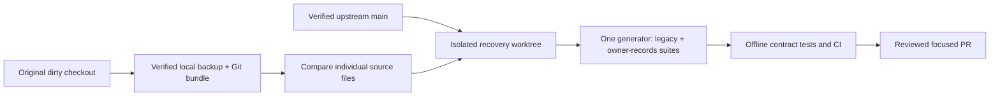

# Engineering checkpoint

## Recovery: October 21, 2026

Verified upstream `main`: `04c9ddb6e0f28614028abf2710bbb9cc75f87488`.
PRs 15/16/17 are merged. PR 17 post-merge run
[39529372088](https://github.com/TRAPZZY/biznoryx/actions/runs/39529372088)
completed successfully. PRs 7/12/14 remain open and are not part of this change.

The original checkout is still on `codex/synthetic-record-fixtures` at `d152c82`.
There were no tracked edits, but these untracked groups contain unfinished work:

| Local content | Compared with current main | Recovery decision |
| --- | --- | --- |
| `android/`, `mobile/`, Android local testing note | Separate earlier Android work | Preserve untouched; never bulk stage |
| `docs/extraction-evaluation.md` | Same path as PR 17 but different text | Preserve both; retain main document and add reconciliation section |
| `scripts/generate-record-fixtures.mjs` | Overlaps PR 17 `generate-extraction-fixtures.mjs` | Recover rendering behind existing canonical generator, no second public generator |
| `scripts/evaluate-record-fixtures.mjs` | No corresponding scorer on main | Recover bounded offline scorer through canonical evaluation entry point |
| `tests/fixtures/everyday-records/` | Main only has a different nine-case generator | Recover owner-supplied detailed inputs/truth as a named additional suite |
| `tests/record-extraction-fixtures.test.mjs` | Main tests generation/separation only | Recover exact/provenance/unknown/duplicate regression checks; retain main tests |
| Generated PNG/HTML/text/index | New local artifacts, not production evidence | Preserve backup; regenerate outputs outside Git, not runtime data |

The suites are not interchangeable: PR 17 uses smaller examples and integer minor
units, while the local version has the exact eight owner-supplied Nigerian
scenarios (nine captures), multiple amounts, explicit/derived/unknown provenance,
corrections, ambiguous candidates and a scorer. Neither is an OCR implementation.
No guessed conversion of one answer format into the other is appropriate.

Safe local recovery backup (not committed):
`C:/Users/traph/.codex/backups/biznoryx-20261021-recovery-df77a68c`.
Full Android/mobile/fixture directory copies were compared with a second
read-only `robocopy /L`; individually copied unfinished source/docs matched SHA-256.
`repository.bundle` verified as complete Git history. No original files were
deleted, renamed, reset or overwritten, including the conflicting local document.

Development continues in the managed worktree
`C:/Users/traph/.codex/worktrees/recover-record-evaluation/biznoryx`, branch
`codex/recover-record-evaluation`, starting from upstream main. Dependencies
installed with `npm ci --no-audit --no-fund` (71 packages; existing deprecation
warnings only). Reference files under `sources/` remain read-only.

## Canonical evaluation boundary

Keep `scripts/generate-extraction-fixtures.mjs` as the public generation command,
preserving its default PR 17 suite. Add an opt-in `owner-records` suite and an
offline scoring entry point. Input definitions/rendering never receive expected
answers. Answer metadata remains evaluator-only. Generated imagery stays under
gitignored `test-results/`; representative real-world/provider validation is
still required. Extraction has no application route or provider call.

## Production evidence

Read-only Northflank UI confirms API service `biznoryx` is Running on
`04c9ddb6e0f28614028abf2710bbb9cc75f87488`, build `affluent-crib-2519`,
one instance `biznoryx-5568599c7c-s992f`, zero restarts. Main CI/CD is enabled.
Prior builds `resilient-eggs-6540` (200b14f) and `sunny-expert-181` (d152c82)
remain listed for runtime rollback. No deployment operation was triggered.

Worker `biznoryx-worker` is Running on the same SHA, build `stable-achiever-8799`,
one instance `biznoryx-worker-5d49cf5ff6-z9ndx`, zero restarts, command
`node scripts/production-worker.mjs`. Its logs contain an **ongoing**, once-per-minute
SQLSTATE 42501: permission denied for `runtime_pending_trial_organizations`.
This predates this recovery and is not an extraction/Updates delivery failure.

Read-only transactions through the worker's existing database connection confirmed:

- The current role is neither superuser nor BYPASSRLS. The repository's expected
  `biznoryx_app` role is absent from `pg_roles`; its grants cannot be assumed applied.
- `runtime_pending_trial_organizations(integer)` exists but is not executable by
  the connected worker role. No grant was applied to conceal this incident.
- `billing_payments`, `organization_features`, `notification_events`,
  `notification_recipients`, `notification_preferences` are absent from the catalog
  for that connection, not merely hidden by row-level policies.
- `schema_migrations` contains 24 rows ending at
  `0024_evidence_report_definitions.sql`. Later trial functions nevertheless exist:
  the ledger alone is therefore not an authoritative full-schema inventory.
- The API database identity/role still needs independent comparison. Do not assume
  its connection is identical to the worker's or blindly replay migrations 0025+.
- No notification flag rows or delivery status can be queried when their relations
  are absent. Migration 0033/permissions/activation are **not ready** on the checked
  worker connection; no feature was activated.

Northflank addon `biznoryx-db` is PostgreSQL 18, TLS/private networking, Running.
Latest snapshot `biznoryx-auth-hotfix-20261013` is Completed (6 GB, October 13
12:08:29-12:09:24); its page says **No restores found**. An October 6 snapshot
also exists. Backup schedules has no configured schedule. Snapshot availability
does not establish tested restore readiness or current recovery coverage.

Before any separately approved production repair: compare API and worker database
identities, inspect the exact additive schema/grant gap using the real runtime
roles, obtain a fresh approved backup and isolated restore evidence, rehearse on
disposable PostgreSQL, and present exact SQL for approval. Never create a guessed
billing table, bypass subscription checks, or use destructive down migrations.
No production writes, migrations, secrets/settings changes or feature activation
are authorized by this checkpoint.

## Recovery verification

Fresh local `npm run verify` passed: 383 tests passed, 16 database-dependent tests
skipped, zero failures; format/lint/typecheck/migration/security/build passed.
An additional scorer CLI regression was then added and the focused suite passed
9/9 (full CI must verify the final head). `npm run test:browser` passed all 46
desktop/mobile journeys. Owner-record PNG generation passed all nine nonblank
canvas-pixel checks; the rotated duplicate was visually inspected. These are
fixture/render/scorer tests, not OCR accuracy. CI now renders owner PNGs after
installing Chromium. Production PostgreSQL is never a test target.

Recovery PR, final head/merge/run and post-merge deployment are pending. Runtime
source files, migrations, production settings and subscriptions are unchanged.

## Workstream state

| Workstream | Code | Tests | GitHub | Deployment | Remaining blockers |
| --- | --- | --- | --- | --- | --- |
| Source downloads | Implemented | PR 15 evidence | Merged | Prior verified, current runtime includes it | Physical installed Android UI not claimed |
| In-app Updates | Implemented, default off | PR 16 evidence; fresh browser 46/46 | Merged | Code included; worker DB lacks schema | Reconcile API DB/0033/grants, separately approve migration/activation |
| Extraction evaluation | Legacy plus recovered owner suite/scorer | Focused 9/9; verify/browser passed | PR 17 merged; recovery PR pending | No runtime feature | Provider approval and real-world evaluation absent |
| Capture/proposal/review/import | Not implemented | Not run | Not started | Disabled/unavailable | Provider/privacy/security/accuracy gates; immutable reviewed normalized layer |
| Capital protection | Not implemented | Not run | Not started | Not deployed | Versioned dated balances/obligations/assumptions and financial fixtures |
| Leakage investigations | Not implemented | Not run | Not started | Not deployed | Transaction/units/allocation layer; concurrency invariants |
| Guided plans | Existing actions/outcomes only | Existing evidence only | Extension not started | Existing actions only | Extend acceptance/review/baseline versions without parallel task system |
| Portable evidence | Existing report exports only | Existing export tests only | Extension not started | Existing exports only | Source register/versioned manifest/context/coverage |
| Optional email/push | Not implemented | Not run | Not started | Not enabled | Provider/platform/privacy approval; per-channel tests |

Update this document with final tested SHA, PR/run/merge, actual deployment proof,
skipped checks and any required operation approval after each completed slice.
