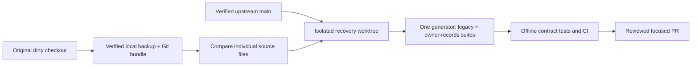

# Engineering checkpoint

## Recovery: October 21, 2026

Verified upstream `main`: `04c9ddb6e0f28614028abf2710bbb9cc75f87488`.
PRs 15/16/17 are merged. PR 17 post-merge run
[39529372088](https://github.com/TRAPZZY/biznoryx/actions/runs/39529372088)
completed successfully. PRs 7/12/14 remain open and are not part of this change.

The original checkout is still on `codex/synthetic-record-fixtures` at `d152c82`.
There were no tracked edits, but these untracked groups contain unfinished work:

| Local content | Compared with current main | Recovery decision |
| --- | --- | --- |
| `android/`, `mobile/`, Android local testing note | Separate earlier Android work | Preserve untouched; never bulk stage |
| `docs/extraction-evaluation.md` | Same path as PR 17 but different text | Preserve both; retain main document and add reconciliation section |
| `scripts/generate-record-fixtures.mjs` | Overlaps PR 17 `generate-extraction-fixtures.mjs` | Recover rendering behind existing canonical generator, no second public generator |
| `scripts/evaluate-record-fixtures.mjs` | No corresponding scorer on main | Recover bounded offline scorer through canonical evaluation entry point |
| `tests/fixtures/everyday-records/` | Main only has a different nine-case generator | Recover owner-supplied detailed inputs/truth as a named additional suite |
| `tests/record-extraction-fixtures.test.mjs` | Main tests generation/separation only | Recover exact/provenance/unknown/duplicate regression checks; retain main tests |
| Generated PNG/HTML/text/index | New local artifacts, not production evidence | Preserve backup; regenerate outputs outside Git, not runtime data |

The suites are not interchangeable: PR 17 uses smaller examples and integer minor
units, while the local version has the exact eight owner-supplied Nigerian
scenarios (nine captures), multiple amounts, explicit/derived/unknown provenance,
corrections, ambiguous candidates and a scorer. Neither is an OCR implementation.
No guessed conversion of one answer format into the other is appropriate.

Safe local recovery backup (not committed):
`C:/Users/traph/.codex/backups/biznoryx-20261021-recovery-df77a68c`.
Full Android/mobile/fixture directory copies were compared with a second
read-only `robocopy /L`; individually copied unfinished source/docs matched SHA-256.
`repository.bundle` verified as complete Git history. No original files were
deleted, renamed, reset or overwritten, including the conflicting local document.

Development continues in the managed worktree
`C:/Users/traph/.codex/worktrees/recover-record-evaluation/biznoryx`, branch
`codex/recover-record-evaluation`, starting from upstream main. Dependencies
installed with `npm ci --no-audit --no-fund` (71 packages; existing deprecation
warnings only). Reference files under `sources/` remain read-only.

## Canonical evaluation boundary

Keep `scripts/generate-extraction-fixtures.mjs` as the public generation command,
preserving its default PR 17 suite. Add an opt-in `owner-records` suite and an
offline scoring entry point. Input definitions/rendering never receive expected
answers. Answer metadata remains evaluator-only. Generated imagery stays under
gitignored `test-results/`; representative real-world/provider validation is
still required. Extraction has no application route or provider call.

## Production evidence

Read-only Northflank UI confirms API service `biznoryx` is Running on
`04c9ddb6e0f28614028abf2710bbb9cc75f87488`, build `affluent-crib-2519`,
one instance `biznoryx-5568599c7c-s992f`, zero restarts. Main CI/CD is enabled.
Prior builds `resilient-eggs-6540` (200b14f) and `sunny-expert-181` (d152c82)
remain listed for runtime rollback. No deployment operation was triggered.

Worker `biznoryx-worker` is Running on the same SHA, build `stable-achiever-8799`,
one instance `biznoryx-worker-5d49cf5ff6-z9ndx`, zero restarts, command
`node scripts/production-worker.mjs`. Its logs contain an **ongoing**, once-per-minute
SQLSTATE 42501: permission denied for `runtime_pending_trial_organizations`.
This predates this recovery and is not an extraction/Updates delivery failure.

Read-only transactions through the worker's existing database connection confirmed:

- The current role is neither superuser nor BYPASSRLS. The repository's expected
  `biznoryx_app` role is absent from `pg_roles`; its grants cannot be assumed applied.
- `runtime_pending_trial_organizations(integer)` exists but is not executable by
  the connected worker role. No grant was applied to conceal this incident.
- `billing_payments`, `organization_features`, `notification_events`,
  `notification_recipients`, `notification_preferences` are absent from the catalog
  for that connection, not merely hidden by row-level policies.
- `schema_migrations` contains 24 rows ending at
  `0024_evidence_report_definitions.sql`. Later trial functions nevertheless exist:
  the ledger alone is therefore not an authoritative full-schema inventory.
- An independent API-shell read-only query confirms the same database and role as
  the worker. Do not blindly replay migrations 0025+: cancellation columns and
  the revenue-breakdown column exist despite their absent ledger entries.
- On this runtime connection, `ingestion_runs`, `organization_billing_subscriptions`,
  `organization_memberships` and `organizations` are owned by the connected role,
  with RLS enabled but not forced. Table owners can bypass those policies. This
  is a database-defense gap, not evidence that a cross-tenant request succeeded;
  API authorization must remain intact. `manual_entry_drafts` and
  `manual_entry_submissions` have forced RLS and are not owned by this role;
  `billing_trials` has RLS and a different owner. Changing ownership, roles or
  FORCE RLS without testing security-definer dependencies could break production.
- No notification flag rows or delivery status can be queried when their relations
  are absent. Migration 0033/permissions/activation are **not ready** on the checked
  worker connection; no feature was activated.

Northflank addon `biznoryx-db` is PostgreSQL 18, TLS/private networking, Running.
At initial inspection snapshot `biznoryx-auth-hotfix-20261013` was Completed (6 GB, October 13
12:08:29-12:09:24); its page says **No restores found**. An October 6 snapshot
also exists. Backup schedules has no configured schedule. Snapshot availability
does not establish tested restore readiness or current recovery coverage.

The user subsequently authorized **a fresh snapshot only**. Snapshot
`biznoryx-preflight-20261021` is now confirmed Completed, Disk, 6 GB, duration
October 21 04:26:27-04:27:34 in the Northflank UI's displayed time zone. Addon
returned to Running. The snapshot page still says No restores found. No schedules,
restores, role changes, grants, schemas, customer records or flags were modified.
Local screenshot proof is preserved in the recovery backup's
`evidence/northflank-snapshot-completed.png` (not committed).

Before any separately approved production repair: compare API and worker database
identities, inspect the exact additive schema/grant gap using the real runtime
roles, obtain a fresh approved backup and isolated restore evidence, rehearse on
disposable PostgreSQL, and present exact SQL for approval. Never create a guessed
billing table, bypass subscription checks, or use destructive down migrations.
No production writes, migrations, secrets/settings changes or feature activation
are authorized by this checkpoint.
See [production schema reconciliation](runbooks/production-schema-reconciliation.md)
for dependency-ordered review and stop conditions; it authorizes no production SQL.

## Recovery verification

Fresh local `npm run verify` passed: 383 tests passed, 16 database-dependent tests
skipped, zero failures; format/lint/typecheck/migration/security/build passed.
An additional scorer CLI regression was then added and the focused suite passed
9/9 (full CI must verify the final head). `npm run test:browser` passed all 46
desktop/mobile journeys. Owner-record PNG generation passed all nine nonblank
canvas-pixel checks; the rotated duplicate was visually inspected. These are
fixture/render/scorer tests, not OCR accuracy. CI now renders owner PNGs after
installing Chromium. Production PostgreSQL is never a test target.

Recovery [PR 18](https://github.com/TRAPZZY/biznoryx/pull/18) is open. Its tested
code head `11744692900156dcbb5cf896ea7f1482998c20ae` passed
[CI 39569058469](https://github.com/TRAPZZY/biznoryx/actions/runs/39569058469):
384 unit tests passed, 16 database-dependent unit skips, 46 browser journeys,
10 durable/native/runtime PostgreSQL tests, 17 manual-entry/trial/Updates database
tests, PostgreSQL RLS acceptance and production dependency audit passed. CI rendered
all nine owner PNGs. CodeRabbit skipped review; manual diff/security-scope review
found no remaining actionable recovery-code findings. Snapshot/recovery documentation
was appended afterward; final-head CI must pass before merge.

The PR's final release-evidence comment records its tested head, merge SHA,
post-merge CI, observed API/worker deployments and health. Do not infer these from
this pre-merge checkpoint. Runtime source, migrations, settings and subscriptions
remain unchanged by the recovery code.

Independent PRs remain excluded: 7 (head 36bfeda) and 12 (head f169cee) report
merge conflicts and include overlapping mobile changes plus a competing migration
0033. Their successful historical Android/verify checks are not current-main
compatibility evidence. PR 14 (head 9fde393) is mergeable with historical checks
passing, limited to Resend handling/tests/runbook, but is not revalidated or merged
here. None has an approval review recorded. Reconcile each independently.

## Workstream state

| Workstream | Code | Tests | GitHub | Deployment | Remaining blockers |
| --- | --- | --- | --- | --- | --- |
| Source downloads | Implemented | PR 15 evidence | Merged | Prior verified, current runtime includes it | Physical installed Android UI not claimed |
| In-app Updates | Implemented, default off | PR 16 evidence; fresh browser 46/46 | Merged | Both services share DB without schema | Reconcile partial ledger/0033/grants, separately approve migration/activation |
| Extraction evaluation | Legacy plus recovered owner suite/scorer | Focused 9/9; verify/browser passed | PR 17 merged; recovery PR pending | No runtime feature | Provider approval and real-world evaluation absent |
| Capture/proposal/review/import | Not implemented | Not run | Not started | Disabled/unavailable | Provider/privacy/security/accuracy gates; immutable reviewed normalized layer |
| Capital protection | Not implemented | Not run | Not started | Not deployed | Versioned dated balances/obligations/assumptions and financial fixtures |
| Leakage investigations | Not implemented | Not run | Not started | Not deployed | Transaction/units/allocation layer; concurrency invariants |
| Guided plans | Existing actions/outcomes only | Existing evidence only | Extension not started | Existing actions only | Extend acceptance/review/baseline versions without parallel task system |
| Portable evidence | Versioned JSON snapshot extension implemented | Focused API/unit and desktop/mobile exports passed | Separate feature PR pending | Not deployed yet | Final CI/merge/deployment; original files/actions/outcomes excluded |
| Optional email/push | Not implemented | Not run | Not started | Not enabled | Provider/platform/privacy approval; per-channel tests |

Update this document with final tested SHA, PR/run/merge, actual deployment proof,
skipped checks and any required operation approval after each completed slice.

## Recovery release verified

PR 18 merged as `9dd6566f9baf1a54ffaa9bee48e6d90d52c151fe`, tested head
`9f42573dc1efbb6776fdfbe033fe21c9feccbfac`. Final PR CI
[39569607898](https://github.com/TRAPZZY/biznoryx/actions/runs/39569607898)
and post-merge CI
[39570007116](https://github.com/TRAPZZY/biznoryx/actions/runs/39570007116)
passed. Northflank API `biznoryx` build `possible-magic-6982`, pod
`biznoryx-76bf49b4d4-kl5k6`, and worker `biznoryx-worker` build
`gleaming-flight-5473`, pod `biznoryx-worker-6cbfbd6d98-jkfl8`, independently
show this exact active SHA, Running, one instance, zero restarts. Automatic main
deployment was observed; no duplicate deployment was triggered. Public healthz
and readyz both returned HTTP 200 after observation. Prior 04c9ddb builds remain
listed for runtime rollback. This does not repair the recorded database issues.

## Portable evidence continuation

Branch `codex/portable-evidence-file` starts from merged PR 18. The existing
authenticated report export now offers an evidence JSON file: allowlisted report
snapshot, exact decimal observations, definition/report/schema versions, source
register, methodology, explanations, limitations and reproducible SHA-256 digest.
The payload explicitly denies external certification and includes no original
source files or action/outcome summaries. It is a downloaded snapshot, not a new
server archive or trusted import. Existing PDF/HTML/CSV and source-download paths
remain separate and unchanged.

Fresh local verify passed (387 tests, 16 PostgreSQL-dependent skips). Focused tests
passed 4/4, including production cookie/native, tenant and premium boundaries.
The browser export/retry tests passed at 1440px and 390px and screenshots were
visually inspected. The first narrow-screen attempt used desktop navigation
setup incorrectly; the test now explicitly sets the intended width before
downloads, while retaining existing desktop/setup and responsive report checks.
No application fix was needed for that test-only timeout. CI now runs the real
PostgreSQL evidence-report contract under its restricted runtime role as well.

Final full-browser, CI, review, merge and live deployment results belong in this
slice's release-evidence PR comment. See
[the runbook](runbooks/portable-evidence-file.md). No new schema, provider, secret,
data mutation or activation is required. Physical Android/WebView behavior remains
unverified. The wider roadmap is not complete: capital protection, leakage,
guided-plan extensions, extraction review/import and external delivery are not
shipped by either of these releases.

## Action plans continuation

Portable evidence PR 19 merged as
`e5e48caa5fc41df2fdebb958d4dcb92a4644dc12`. Its post-merge
[CI 39615785304](https://github.com/TRAPZZY/biznoryx/actions/runs/39615785304)
passed. API build `elastic-lace-8322` and worker build `sure-flowers-8271`
were independently observed running that SHA; healthz and readyz returned 200.

The next branch, `codex/action-plans-workspace`, adds the customer Action plans
page over existing verified actions, not another task store. It supports
finding-backed creation, the authenticated owner, due dates, steps/resources,
source evidence, search/filter and the existing status graph. Read-only roles
have no mutation controls. It adds no migration or activation flag and does not
expose uncertain financial outcomes. See [its runbook](runbooks/action-plans.md).

Focused UI/unit checks passed: 3 unit tests and 5 browser journeys at desktop and
390px mobile, including failed writes, read-only access and unavailable backend.
Local verify passed: 390 tests, 16 database-dependent skips, build/security/syntax
gates. The first browser attempt had an ambiguous test-only source-summary
selector; narrowing it to the evidence details resolved the failure. Both form
and list screenshots are captured. Full browser/CI/PostgreSQL/release evidence
will be attached to the feature PR rather than assumed from local rendering.

Alerts are still blocked on production reconciliation: notification tables and
the expected runtime role are absent; the migration ledger stops at 0024 despite
later objects being present. A fresh completed `biznoryx-preflight-20261021` disk
snapshot exists, but no restore test has been performed. The known trial-function
permission error and missing billing_payments remain separate reviewed repairs.
No SQL, grants, production settings, provider calls or notification activation
were performed during this slice. Each still requires its explicit approval.

The owner subsequently approved an isolated private restore only, with no paid
upgrade. Northflank shows the free addon quota full at 1/1. The disk snapshot's
restore dialog targets the existing production addon, explicitly warning of a
restart/unavailability; it was cancelled without confirmation. No isolated
restore was possible within the available capacity, and production was untouched.

Local full-browser checks passed 52/52. The first PR CI run 39619423354 failed two
existing sign-in journeys after the new tests added five logins to the shared
review runtime. The new browser tests now own per-test review runtimes, including
rate-limit state, matching the existing Updates-test isolation pattern. No auth
limit, production code, assertion or browser timeout was weakened. Final CI must
still pass before merge; the failed run remains part of the release evidence.

## Database repair: paid-plan continuation

PR 20 is merged as `ef014a524847914113a81e030f8c1132f0787778`; upstream main
still points to it. Its post-merge CI 39670047477 passed. The current investigation
branch is `codex/database-notification-repair`, created from that main revision.
Unfinished original-checkout Android/mobile/fixture files remain untouched.

The owner upgraded Northflank to Pay as you go; the authenticated Plans page
confirms it is Active. The prior free-addon quota is no longer the blocker.
The production addon is Running, PostgreSQL 18, TLS/private. Snapshot
`biznoryx-preflight-20261021` is still Completed, Disk, 6 GB, and appears explicitly
in the new addon's source-backup selector. The supported fork workflow creates
an independent addon, unlike the in-place restore dialog previously cancelled.

The owner approved `biznoryx-db-repair` at the displayed $0.0088/hour or
$6.31/month base estimate, with a $1 compute/storage authorization budget and
no automatic increases. It was created from that named snapshot and is now
Running, one PostgreSQL 18 instance, 0.2 shared vCPU, 512 MB, 6 GB NVMe,
TLS enabled, private networking, disk auto-resize off and no connection poolers.
The Forked link points to the exact production snapshot. No production connection,
secret, role, schema, application setting or notification flag was changed.
Actual billed usage has not been reconciled; the quote excludes taxes, transfer
and additional backup charges. The authorization budget is not a provider-enforced
automatic billing cap. Deletion still requires the owner's separate approval.

Production API and worker still show `ef014a5`. Public healthz and readyz returned
200. A later worker observation differs from the prior zero-restart checkpoint:
pod `biznoryx-worker-9758fb7cd-vhz9m` shows five restarts and a crash warning.
The cause is not yet established. Historical logs contain trial-function permission
errors and a connection-failure indicator, but these must not be assigned as the
cause of current pod restarts without scoped log/event evidence.

Northflank's official CLI 0.13.0 was run from npm's cache outside the repository.
The owner approved CLI authorization limited to the test fork. Browser login
offered only the Owner role for a token; account-wide session access was also
broader than approved. Neither was authorized, no API token was created, no role
was saved, and the login process was cancelled. Inspection of the role form and
documentation identified project restrictions, not a verified addon-only grant.
Do not silently substitute project-wide credential access or an Owner token.

The owner approved and the agent created `biznoryx-db-rehearsal`, a manual job
at nf-compute-20 (0.2 shared vCPU, 512 MB), $0.25/1,000 run-minutes. It has a
600-second run limit, zero retries, no schedule/image-change trigger, and at most
60 total run-minutes within the combined $1 temporary-resource authorization.
The UI offered no reusable build service. The official `postgres:18` image is
used as a client with an explicit command override, never as a database server.
Runtime-only group `biznoryx-db-rehearsal-only` links five fork connection fields
and is restricted to that one job: zero production-addon links, no production,
payment or email keys. No Owner CLI token was created.

Two initial read-only probes failed before SQL output. The sanitized second
failure identified certificate verification. The official client image lacked
the CA trust store. Installing the standard Debian CA package in the temporary
container resolved the problem without weakening `verify-full` TLS. Run
`991d93a2-3855-4d02-9936-96e1fec410f3` exited 0 with `CATALOG_PROBE_PASSED`.
The catalog probe refuses non-fork hostnames and sets read-only transactions,
statement/lock/connect timeouts. It emits schema metadata, not customer rows.
Some large extension metadata was truncated in the provider log view; a focused
probe omitting unrelated extension functions is being collected. SQL repairs,
catalog equivalence, restored-data integrity and notification functional tests
on the fork are not yet claimed complete.

Evidence screenshots are local only under
`C:/Users/traph/.codex/backups/biznoryx-db-repair-20261021/evidence/`.
See [the rehearsal record](runbooks/database-repair-rehearsal.md). No production
SQL or activation is authorized by this checkpoint.

## Database repair: 2026-10-26 local-only continuation

This dated checkpoint supersedes the running/cost/isolation assumptions above.
The fork was paused after Northflank displayed $1.02 accrued usage. Storage still
accrues while paused. The owner declined additional active testing spend and
instructed local work only; there have been no further cloud configuration,
GitHub push/merge or production changes in this continuation. Production secret
group settings must remain unchanged. Temporary-resource deletion is not approved.

The dedicated fork group is restricted, but the existing production group is
unrestricted and was also inherited by the rehearsal job. The actual repair run
failed its configuration guard before SQL. Read-only access and all 62 fresh
reference setup/SQL acceptance phases succeeded earlier; restored-source repair
and customer-data preservation are not claimed. See the runbook for run IDs.

Local changes strengthen credential rejection before dependency downloads and
database connections, and check runtime privileges/disabled flags before commit.
A disposable loopback-only PostgreSQL 18 cluster enabled fresh verification:
61 canonical SQL phases, 13 runtime checks, 17 manual/trial/Updates checks,
4 synthetic repair checks, and the same 30 database-backed checks against the
repaired synthetic schema all passed. This exercises rollback, tenant isolation,
native/browser CSRF boundaries, notification delivery/retries/preferences and
billing backfill without touching real records or activating production features.
Fresh `npm run verify` also passed all quality/build gates: 397 passed, zero
failed, 17 database-dependent/opt-in tests skipped in that environment; the
applicable database tests were separately executed as listed above. The earlier
52-pass browser result is dated 2026-10-22, not a new production validation.

The draft ownership repair is local rehearsal tooling, not an approved production
runbook. Exact restored-schema preservation, provider-role behavior, production
lock/recovery assessment and separately approved notification activation remain
outstanding. No application source or existing migrations were rewritten.

## Database repair: GitHub delivery and live recheck

The owner subsequently requested autonomous completion and production delivery.
GitHub delivery is now in scope again. The declined fork spending and unchanged
production-secret scope remain binding; exact SQL and scoped activation still
require the established release gates. No additional paid run was started.

GitHub main, Northflank API and worker were rechecked at `ef014a524847914113a81e030f8c1132f0787778`.
Both services show Running, five historical restarts and a crash-warning indicator;
the cause is unverified. `/healthz` and `/readyz` each returned HTTP 200. These are
fresh endpoint checks, not proof that missing notification schema is repaired.
Fresh worker logs on 2026-10-26 still show the trial-maintenance function failure
and SQLSTATE 42501 repeating at one-minute intervals. This remains a live release
blocker, distinct from the unproven cause of historical container restarts.

The ownership draft now also fails closed when granting the app group would
introduce privileged SET ROLE access. The focused synthetic repair/tooling run
passed 12 checks without skips. CI now independently provisions a synthetic
PostgreSQL 18 database to run that repair and all 30 existing database-backed
runtime/manual/trial/Updates checks afterward. It cannot access Northflank or
production data. Publication of this tooling is not production SQL execution;
the restored-fork preservation and rollout evidence remain outstanding.
