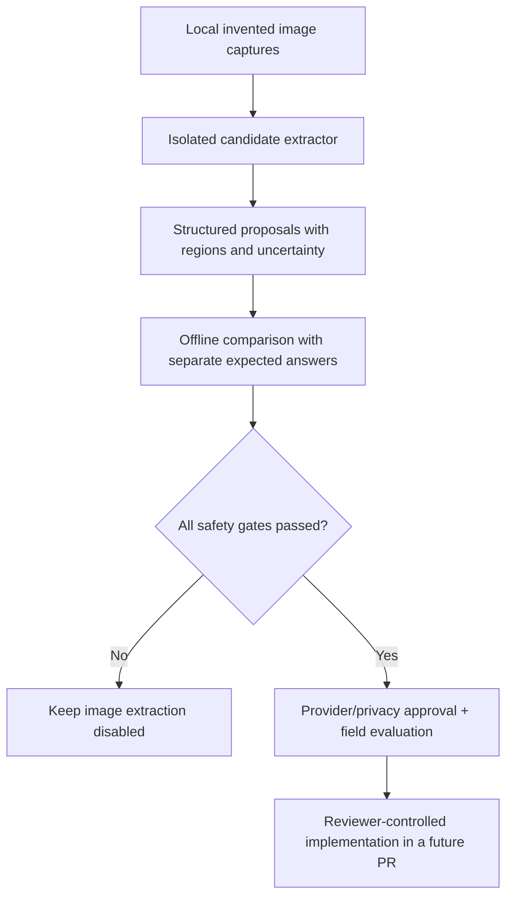

# Everyday records: synthetic receipt and notebook extraction evaluation

Status: **evaluation preparation only**. The feature is not integrated, enabled or advertised in production. This document is a newly reconstructed continuation of an interrupted Codex workspace; it is not a recovered copy of the original uncommitted draft.

## Recovered owner-records suite

The October 21 reconciliation recovered the original, more detailed owner-supplied
examples without replacing the smaller PR 17 baseline. There is still one public
generator; its default output and tests remain unchanged:

```sh
node scripts/generate-extraction-fixtures.mjs --suite owner-records
node scripts/generate-extraction-fixtures.mjs --suite owner-records --png
node scripts/evaluate-extraction-fixtures.mjs path/to/predictions.json
node --test tests/extraction-evaluation-records.test.mjs
```

Owner outputs live under `test-results/extraction-evaluation/owner-records/`:
`inputs/clean/` contains text/HTML, optional `inputs/visual/` contains PNGs,
`gallery.html` provides a local contact sheet, and `answers/expected.json` is
evaluator-only. Only PNGs should reach a future image extractor. Keep the index,
answer key and source definitions outside its context. The input renderer does
not import the answer key. Never send these files to an unapproved provider.

The nine captures cover the exact original examples: supplier part payment,
daily sales with receivable, business expenses versus owner withdrawal,
uncompleted service with deposit, corrected flour quantity, unresolved oil
amount, two photographs of the same supplier receipt, and repayment of an old
receivable. Monetary/quantity values are decimal strings, not the legacy
suite's minor-unit schema. Explicit, derived, confirmed-context and unknown
values remain distinct; carton capacity, tax and job completion are not guessed.

Predictions use `{ "cases": [...] }`. Each case supplies `fixtureId`, `recordType`,
`fields` (flat field-name keys mapped to `{ value, provenance, candidates? }`),
`requiredReviewDecisions`, optional `relationships` and `claims`. Unknown values
must stay null with provenance `unknown`; ambiguous candidates must be preserved.
Relationship proposals require review; setting `importApproved: true` always
fails. The scorer reports field/provenance errors, unsafe guesses, missing review,
duplicate/missing case results and prohibited classifications. It does not read
images or invoke OCR. Exit codes are 0 (contract match), 1 (mismatch), 2 (invalid
input); prediction input is capped at 2 MiB and 100 cases.

The scorer's exact-answer self-test validates only the scorer contract, not
recognition accuracy. Local cursive fonts, deliberate visual ambiguity and
photographic transforms are synthetic, not proof of Nigerian handwriting
performance. No runtime routes, schema changes, flags or analytics imports are
introduced by this recovery.

## Purpose and non-goals

Establish a reproducible, privacy-safe local fixture set to evaluate a future *proposal-only* extraction workflow for receipts, handwritten daily sales notes and cashbooks. The existing CSV, PDF and manual-entry workflows remain the only supported input paths. Never treat a proposed extraction as verified ledger data: a business-authorized reviewer must confirm the source, interpretation and posting intent before an immutable import version is created.

This package does **not** select an OCR/AI provider, prove OCR accuracy, upload customer content, introduce a provider API key, create a new upload route, alter tenant records, change calculations, or authorize a schema migration. The nine invented examples are useful for testing contracts; they are not representative Nigerian-field evidence or a basis for shipping automated extraction.

## Local generation and isolation

Run from the repository root using locked development dependencies:

```sh
node scripts/generate-extraction-fixtures.mjs
# For rasterized, image-only evaluation inputs (requires installed Playwright Chromium):
node scripts/generate-extraction-fixtures.mjs --png
node --test tests/extraction-evaluation.test.mjs
```

When Chromium is not installed, use the repository's existing development setup to install it before the `--png` command. Neither generation mode calls an external provider. The optional PNG rendering uses local Chromium and system fonts; different OS/font versions may produce different PNG pixels. Source SVG output and ground truth JSON are deterministic. Generated results are in the already-gitignored `test-results/extraction-evaluation/` directory:

```text
test-results/extraction-evaluation/
  inputs/          # 01...09 SVG; 01...09 PNG if --png was requested
  answers/
    expected.json  # test harness only: NEVER feed to extractor
```

For genuine image-only scoring, pass **only** the PNG files from `inputs/` to the extractor. SVG text can be read directly as XML and would invalidate OCR measurement. The answer key must be opened only by an evaluation process after predictions are finalized. Never insert inputs or outputs into BIZNORYX's customer ingestion tables, object store or analytics pipeline.

## Nine capture cases and expected behavior

All businesses, receipt numbers, transaction descriptions and values below are invented, with no names, addresses, phone numbers, IDs or real customer records.

| Capture | Scenario | Essential evaluation requirement |
| --- | --- | --- |
| 01 | Clean printed cash sale, NGN 750 | Correct amount, date, sale classification |
| 02 | Printed wholesale purchase, NGN 56,000 | Expense/purchase, not sales revenue |
| 03 | Notebook-style sale, NGN 7,200 | Date normalization, line amount |
| 04 | Notebook correction: quantity 5 corrected to 4, NGN 6,000 | Preserve both readings; require human review |
| 05 | Ambiguous price `NGN 1?00` | Amount unknown; abstain rather than invent digits |
| 06 | Loan principal repayment received, NGN 10,000 | Cash in but **not** sales revenue |
| 07 | Receipt duplicate, capture A, NGN 6,000 | Propose at most one business event |
| 08 | Same receipt photographed differently, capture B | Detect duplicate by source/event identity, not only file hash |
| 09 | Cropped receipt, date and quantity unavailable | Preserve known amount, request missing fields |

The duplicated receipt's files intentionally differ while its commercial transaction identifier is shared. Do not infer separate sales from different image hashes. Capture 04 intentionally exposes a correction; the extracted final value may be proposed but must not auto-post without confirmation. Capture 05 is an explicit abstention test, not a multiple-choice guess. Capture 09 is an incomplete source requiring manual completion or rejection.

## Suggested proposal contract (future implementation, not an existing API)

Treat each field as `{ value, confidence, source_region, status }` where status is `observed`, `uncertain`, or `missing`; confidence must not be substituted for evidence. Preserve exact naira/kobo values as decimal strings or integer minor units, not floating-point sums. Associate the proposal with an immutable capture ID, captured-at timestamp, tenant/business owner, normalization/schema version, original source hash and a list of review reasons. A duplicate candidate references an existing source/business event rather than creating a second transaction. For unsupported source content, store an explicit failure or review status; never fabricate amounts, dates, parties or categories.



## Evaluation method and release gate

1. **Freeze inputs:** record capture manifest, image hashes, rasterization environment and extractor/model version. Exclude `answers/` from model context, prompts, retrieval and the outbound request body.
2. **Capture outcomes:** evaluate transaction ID, date, currency, amount in minor units, financial type, line quantities, flags for human review, duplicate grouping, missing fields, and traceable source regions. Missing optional data stays unknown, not zero.
3. **Score separately:** report exact-match per field and per document, number of manual-review cases, false-accept rate, false-duplicate/missed-duplicate rate, and category-confusion matrix. Count abstentions on ambiguous inputs as correct when aligned to expectations; never hide them by excluding uncertain records.
4. **Check harmful errors:** zero unattended postings, zero unsupported amounts, no repayment counted as revenue, no duplicate transactions, and no cross-tenant source or answer exposure. These are release blockers even if aggregate OCR accuracy is high.
5. **Evaluate real operating conditions:** an independently approved, fully de-identified sample set from representative Nigerian paper receipts/notebooks (lighting, blur, handwriting, symbols, languages, mixed cash/credit, alterations, refunds, currencies) must be assessed with documented reviewer agreement. The nine toy fixtures alone cannot measure this.
6. **Approve processing/security:** before sending any customer image externally, obtain written approval for the exact provider, data flows, processor agreement, geographic transfers, retention/deletion, logging and training-use policy, request size caps, encryption, cost per image and a documented incident/rollback strategy. No approved provider is assumed today.
7. **Only then implement:** ship tenant-authorized upload validation, safe MIME/size checks, malware risk controls, private storage, asynchronous proposal review, durable retries, audit events, idempotent approved imports, strict RBAC/RLS, unit/API/database/browser tests and a disabled-by-default feature flag in a separate gated release.

A passing synthetic fixture test proves only generation determinism and separation. It does **not** prove OCR recognition, finance classification accuracy, production readiness or approval to activate image extraction.

## CI and deployment boundaries

- `npm test` includes a no-network fixture-generation contract test. It writes only to a temporary directory and deletes its outputs.
- The generator is opt-in, has no database client and does not import into analytics. The optional PNG output requires the local Chromium binary; it is not invoked by regular unit tests.
- `main` automatically deploys the API on Northflank, so even documentation/test changes should enter through a CI-checked PR. No Northflank console action, worker restart, production database migration or organization enablement is authorized by this evaluation package.
- Notification migration `0033` belongs to the separately merged Updates feature and remains an independent, approval-gated operational decision. Do not run its down migration on production or conflate notification activation with extraction-readiness.
