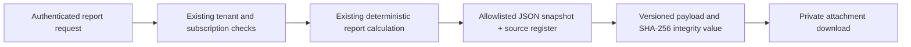

# Portable evidence file, version 1

## Delivered boundary

The report toolbar's file-JSON icon downloads the selected report as an
authenticated JSON attachment through the existing `/api/evidence-report`
endpoint with `format=json`. Cookie/native authentication, active organization,
repository authorization and premium-subscription checks remain unchanged.
No public link or alternate authorization route is created. Responses are
`private, no-store`, attachments and `nosniff`; original source downloads remain
the separate Data Workspace workflow.

The payload includes the report/calculation version, selected metric and approved
definition (or explicit unconfirmed state), reporting/comparison periods, exact
decimal observations, source register/checksums/references, methodology, findings,
explanations and coverage limitations already calculated by the report engine.
Only allowlisted report fields are copied. Navigation choices are excluded.
No metrics, business context, action outcomes or source bytes are invented.

This is the first portable-evidence slice, not the complete future evidence
workstream. Original files and action/outcome summaries are not included. The
download is a snapshot in the user's possession, not a new durable server archive.
Sharing the file discloses business data; it is not encrypted or independently
certified, and does not establish creditworthiness or an audited business balance.

## Format and integrity

`payload.schemaVersion` is `biznoryx.evidence-file.v1`. Report engine and metric
definition versions are retained separately. Unknown values remain unknown;
decimal-string metric values are not converted to floating point.

`integrity.value` is the lowercase SHA-256 digest of UTF-8
`JSON.stringify(file.payload)`, using the parsed payload's property order and no
pretty-print whitespace. Top-level pretty-printing does not change this check.
Do not reorder payload keys before verifying. A new generated-at timestamp can
change the digest even when observed metrics have not changed.

Recompute the checksum independently after parsing the downloaded JSON and compare
with the trusted original. An adversary can edit the file and recompute its hash:
this is **not a digital signature or proof of BIZNORYX origin**. The limitation is
also embedded inside the hashed payload. The application does not ingest these
files or treat them as newly verified business evidence.

## Release and rollback

No migration, secret, provider or feature activation is required. Existing
production schema/RLS/grant issues remain separate blockers for their affected
workflows; this change does not repair or bypass them. CI exercises restricted-role
PostgreSQL mappings, viewer/foreign-tenant exports and subscription denial, plus
desktop/narrow downloads and existing PDF/HTML/CSV regression paths.

Rollback uses the prior Northflank runtime build or a normal code revert. There
is no new persistent state to remove. A physical Android/WebView download test
remains outstanding; native bearer API verification is not that device test.
