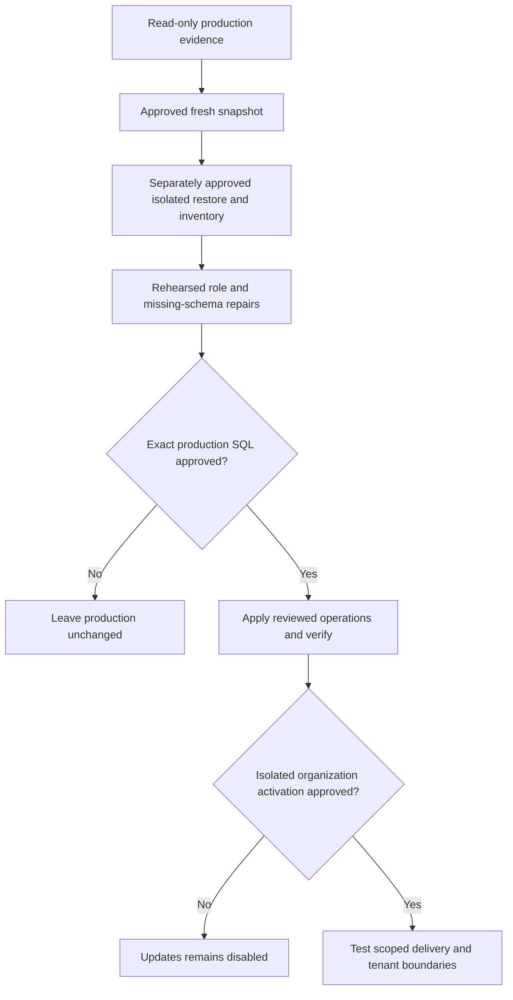

# Production schema reconciliation: approval gates

## Observed October 21, 2026

See the [engineering checkpoint](../engineering-checkpoint.md) for recovery,
deployment and read-only catalog evidence. Both services use the same database
and runtime role. The ledger ends at 0024 but later objects exist. A naive
"apply every later migration" operation would collide with existing objects.

| Boundary | Observed gap | Required separate operation |
| --- | --- | --- |
| Payment history | `billing_payments` absent | Rehearse 0025 including its checkout-history backfill and grants; authorize separately |
| Trial maintenance | Function exists, EXECUTE denied | Reconcile actual runtime identity with bootstrap 011; never grant PUBLIC access |
| Tenant database defense | Runtime owns several non-forced RLS tables | Rehearse a non-owner runtime role and security-definer ownership/grants; no blind FORCE RLS |
| Updates | All four feature/event/recipient/preference tables absent | Approve 0033 and runtime-specific minimum grants only after prerequisites |
| Recovery | Historical snapshot had no restore history/schedule | Verify approved fresh snapshot; separately authorize isolated restore drill/scheduling |

The trial migration conditionally grants to `biznoryx_app`, and bootstrap 011/012
explicitly target that role. It is absent in the observed production catalog.
The actual role's inability to execute trial maintenance explains the recurring
42501 worker error. This is not a reason to disable billing security or claim an
empty notification queue. No unauthorized cross-tenant request was demonstrated.

## Dependency-ordered repair review

1. Freeze the exact API/worker revision and record a completed fresh disk snapshot.
   A snapshot is not proof of restoration. Never restore over production to test it.
2. Obtain approval for an isolated recovery environment and restore drill before
   claiming disaster recovery works. Keep its data private; no external processors.
3. Inventory objects, columns, constraints, policies, function signatures/owners,
   role memberships and grants on that restored copy. Compare definitions against
   migrations 0025-0033; ledger gaps do not authorize replay or retroactive marking.
4. Rehearse runtime-role changes separately. Preserve browser/native session
   helpers, worker locking, tenant transactions, and security-definer ownership.
   Prove missing/foreign tenant contexts fail on a non-owner NOBYPASSRLS connection.
   Any new credentials or Northflank connection change needs separate approval.
5. Prepare a reviewed, exact SQL change set for the demonstrated gaps only.
   Migration 0025 backfills existing billing checkout records: explicitly disclose
   that data write. Do not create a substitute payment table or infer paid status.
6. After role/schema compatibility is demonstrated, propose the existing
   `0033_in_app_updates.sql` transaction and the exact runtime grants corresponding
   to `012_in_app_updates_grants.sql`. Leave every organization disabled. Do not
   run bootstrap scripts with an unverified role name or invoke delivery functions
   during a read-only diagnostic transaction.
7. Request approval for the exact production operations, expected locks, backup,
   stop conditions and rollback route. No SQL in this runbook is pre-approved.
8. After approved operations, verify catalogs, health/readiness and worker logs,
   then separately request activation of one isolated test organization. Exercise
   real delivery/revocation/retries without modifying real customer records.

## Stop and recovery rules

Stop for unexpected objects, missing backups, failed restore verification,
unrehearsed privilege effects, failed tenant tests or incompatible runtime code.
Do not reset subscriptions, rotate credentials, change worker settings, rewrite
historical KPI records or run destructive down migrations as a shortcut.

For a runtime regression retain the previous known Northflank build. Disable
only the separately authorized organization's Updates flag if its rollout fails;
retain additive history/schema. Role/SQL rollback must be rehearsed separately
and may not be equivalent to application rollback. A snapshot restore is a
last-resort, approved recovery operation, not a routine feature rollback.

